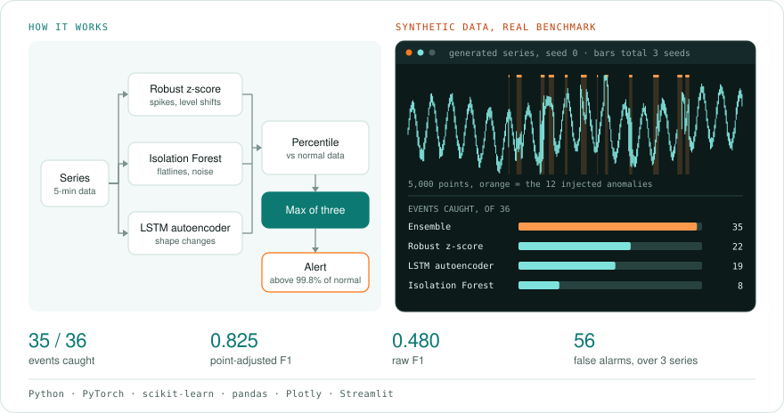
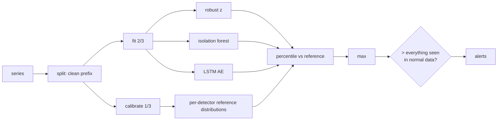

# anomaly-detector

**Catch anomalies in sensor, server and business metrics before they become incidents, and know how well it works.** anomaly-detector runs three complementary detectors, fuses them on a calibrated common scale, and ships a benchmark with labelled anomalies of six kinds. You see measured precision, recall and false-alarm counts, not a demo plot.

 

<!-- author-banner -->
> **Project 08 of 20** in my AI build series, designed and built by **[Abbishekk DGS](https://abbishekkdgs.tech)**. [See all projects →](https://github.com/Abbishekk-DGS)

<!-- overview:start -->
## Overview

<picture>
  <source media="(prefers-color-scheme: dark)" srcset="docs/overview-dark.svg">
  
</picture>

## Interface

You can use it from the terminal or from an interactive dashboard in the browser.

### Terminal

| Command | What it does | Options (default) |
|---|---|---|
| `anomaly-detector bench` | Runs the labelled benchmark | `--seeds` (3) |
| `anomaly-detector detect <csv>` | Scores your own data | `--column` (value), `--train-rows` (first 30%), `--period` (0), `--out` (`anomalies.csv`) |

`--false-alarm-rate` (default 0.002) goes before the command.

### Dashboard

Install it with `uv sync --extra ui`, then start it with `uv run streamlit run src/anomaly_detector/app.py`.

| Area | Controls and views |
|---|---|
| Sidebar | Synthetic or uploaded data, seed or CSV settings, leading fraction known to be normal (0.1 to 0.6) |
| Chart | The series with flagged points in red and true anomalies as orange bands, a lower panel with all three detector scores plus the ensemble and its threshold, and a dotted line at the end of the reference data |
| Scores, on labelled data | Point-adjusted F1, events detected, false-alarm episodes, raw F1 |
<!-- overview:end -->

## Benchmark

5,000-point series (5-minute resolution: daily + weekly seasonality, trend and noise) with 12 injected anomalies per series, 6 kinds: **spike, level shift, noise burst, drift, stuck sensor (flatline), seasonal break**. Mean over 3 seeds, scored on the unseen 70%. Thresholds are calibrated on held-out normal data; **no labels are used to tune them**.

| Detector | F1 | Point-adjusted F1 | PA-F1, oracle threshold | Events caught | False-alarm episodes |
|---|---|---|---|---|---|
| Robust z-score | 0.156 | 0.710 | 0.769 | 22/36 | 51 |
| Isolation Forest | 0.124 | 0.284 | 0.750 | 8/36 | 8 |
| LSTM autoencoder | 0.375 | 0.613 | 0.631 | 19/36 | 18 |
| **Ensemble** | **0.480** | **0.825** | 0.825 | **35/36** | 56 |

Reading the table honestly:

- **The ensemble catches 35 of 36 anomaly events** and matches the oracle-threshold upper bound, without ever seeing a label.
- **The cost is false alarms**: about 19 alert episodes per series, roughly 1–2 a day at 5-minute resolution, and almost all of them are inherited from the z-score detector (51 episodes on its own). The reference window is short (500 points, under 2 days), so the threshold is effectively "above anything seen in normal data". More normal history tightens it.
- Isolation Forest scores badly at the calibrated threshold but well at the oracle threshold (0.75). Its signal is good and its calibration is poor, which is exactly what the max-of-percentiles ensemble compensates for.
- Point-adjusted F1 (Xu et al., 2018) credits a whole anomaly segment if any point in it is flagged. It's the standard metric but a generous one, so raw F1 is reported alongside.

Reproduce: `uv run anomaly-detector bench --seeds 3` (about 10 s on a laptop).

## Detectors

| | How it works | Good at | Blind to |
|---|---|---|---|
| **Robust z-score** | distance from rolling median in rolling-MAD units, on the de-seasonalized signal | spikes, level shifts | slow drift, stuck sensors |
| **Isolation Forest** | window features: level vs normal profile, spread, slope, roughness, repeated-value ratio | flatlines, noise bursts | single-point spikes |
| **LSTM autoencoder** | seq2seq LSTM trained on normal windows; score = reconstruction error | shape changes, seasonal breaks | subtle level offsets |

**Ensemble**: each detector's score becomes its percentile among that detector's scores on held-out normal data, and the ensemble takes the maximum. A point is anomalous if any specialist is more surprised than it ever was on normal data.



## Quickstart

```bash
git clone https://github.com/Abbishekk-DGS/anomaly-detector && cd anomaly-detector
uv sync --extra ui

uv run anomaly-detector bench                                           # the table above
uv run anomaly-detector detect metrics.csv --column cpu --period 288 --train-rows 3000
uv run streamlit run src/anomaly_detector/app.py                        # interactive dashboard
```

`detect` writes every detector's score and an `anomaly` flag per row. `--period` is the seasonal cycle in rows (288 = daily at 5-minute resolution). `--train-rows` is how many leading rows you trust to be normal.

## Development

```bash
uv sync --extra dev && uv run pytest -q
```

## About the author

Built by **Abbishekk DGS**. More of my work at **[abbishekkdgs.tech](https://abbishekkdgs.tech)** and on **[GitHub](https://github.com/Abbishekk-DGS)**.

## License

MIT © Abbishekk DGS
